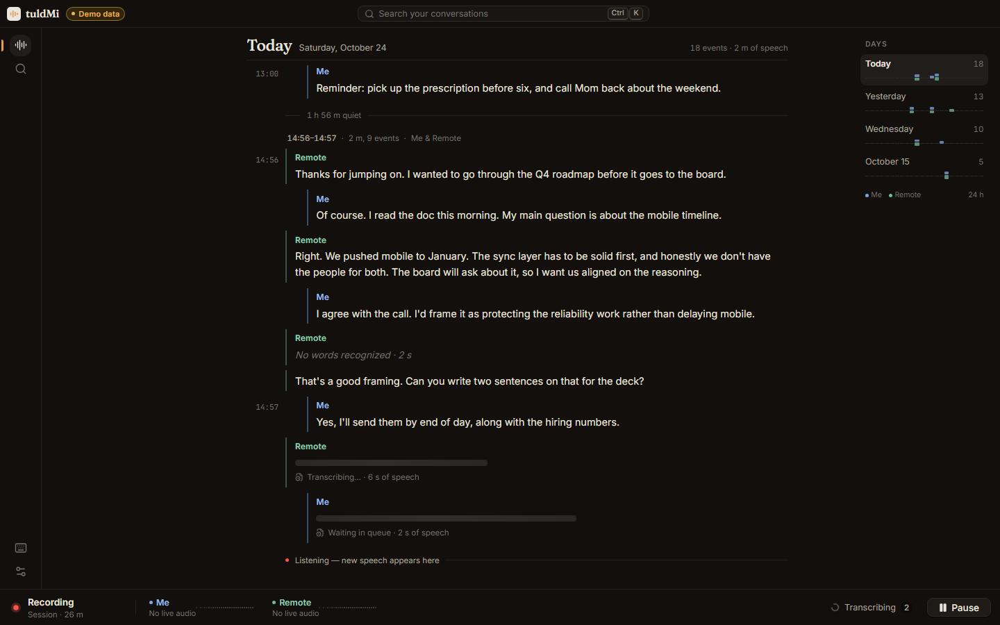
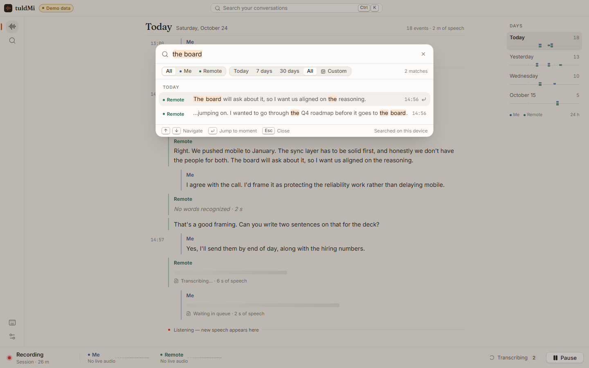
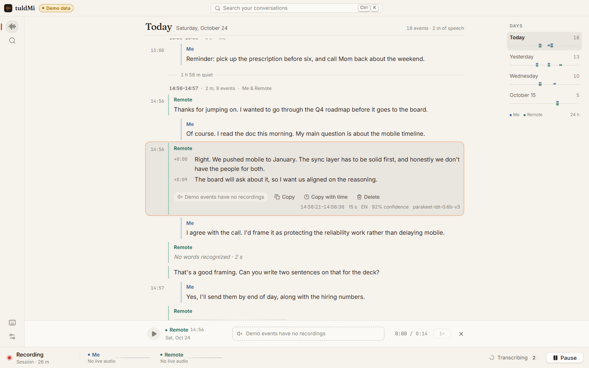
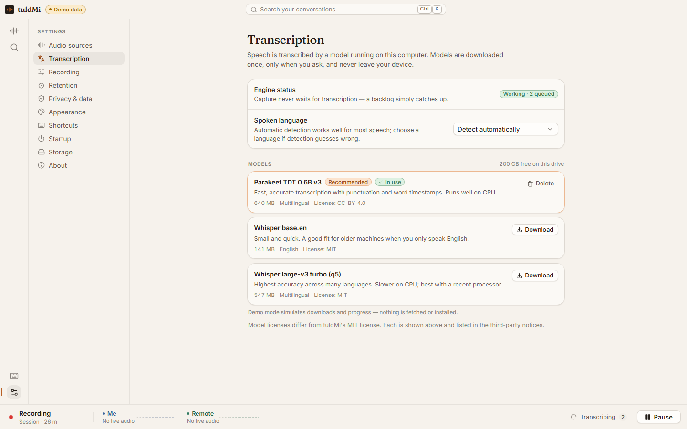
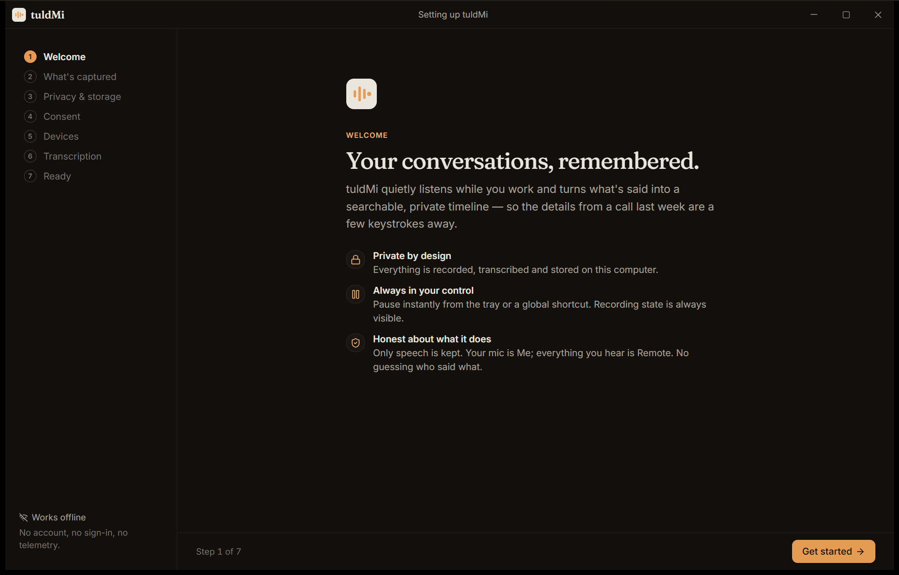

# tuldMi

**Your conversations, remembered.**

tuldMi sits quietly in your system tray, listens to the microphone and system audio you allow,
keeps only the speech, transcribes it on your computer, and gives you a calm, searchable,
playable timeline of what was said. Nothing leaves your device.



> Screenshots of the timeline, search and settings use tuldMi's built-in, clearly labelled
> **demo data** (note the "Demo data" pill); the welcome screen below is the real app.

| | |
|---|---|
|  |  |
|  |  |

## What it does

- **Ambient capture** of your microphone (**Me**) and your computer's audio output (**Remote**,
  e.g. the other side of a call), as separate tracks.
- **Keeps only speech.** Silero voice-activity detection runs locally; silence is never stored.
  Pre-roll (300 ms) and post-roll (700 ms) keep word edges; long speech is split with overlap so
  nothing falls between segments.
- **Local transcription** with whisper.cpp. You choose and download a model on first run (74 MB
  to 547 MB); audio keeps being captured and queued until one is installed.
- **Timeline** grouped by day and conversation, with quiet gaps collapsed, live arrivals that
  never yank your scroll position, and a "Back to live" pill.
- **Instant full-text search** (SQLite FTS5) with highlights, Me/Remote and date filters, and
  jump-to-moment.
- **Playback** of retained audio with a scrubbable waveform and speed control.
- **Retention you control**: delete audio right after transcription, keep 7 days, 30 days, or
  forever. Transcripts are kept independently.
- **Tray-first**: recording state always visible, pause/resume from the tray or a global
  shortcut (default **Ctrl+Shift+`**), closing the window keeps listening (and tells you so).
- **Export** to Markdown or JSON. Delete one event, its audio, or everything.

## Privacy

No accounts, no telemetry, no cloud. The only network request tuldMi ever makes is downloading a
transcription model you explicitly choose, verified by SHA-256. Recording conversations is
regulated — you are responsible for consent laws and workplace policy. Full details, including
what is **not** yet protected (no encryption at rest in v0.1.0): [docs/PRIVACY.md](docs/PRIVACY.md).

## Platforms

| Platform | Status |
|---|---|
| Windows 11 x64 | **Supported** — mic + WASAPI loopback (verified) |
| Windows 10 x64 | **Unverified** — built for it, not yet tested on it |
| macOS | Not yet — architecture ready (`AudioCaptureProvider`), needs a ScreenCaptureKit provider |
| Linux | Not yet — needs a PipeWire provider |

## Install

Download `tuldMi_0.1.0_x64-setup.exe` from the GitHub release and run it (per-user install, no
admin rights needed). The installer, the app and the uninstaller are Authenticode-signed
(`CN=Joseph Spillers`, Azure Artifact Signing, RFC 3161 timestamped). As a new publisher, SmartScreen
may still show a reputation prompt for the first downloads. Verify a download with
`Get-AuthenticodeSignature .	uldMi_0.1.0_x64-setup.exe` and the published `.sha256`.

## Develop

Requirements: Rust (MSVC toolchain), Visual Studio Build Tools (C++), LLVM (libclang), Node 22+.
See [CONTRIBUTING.md](CONTRIBUTING.md).

```
npm install
npm run tauri dev      # the app
npm run dev            # frontend only, in a browser, on labelled demo data
cargo test -p tuldmi-engine
```

Architecture: [docs/ARCHITECTURE.md](docs/ARCHITECTURE.md) · IPC contract: [docs/IPC.md](docs/IPC.md) ·
Models and licenses: [docs/MODELS.md](docs/MODELS.md) · Releasing: [docs/RELEASE.md](docs/RELEASE.md)

## Current limitations (v0.1.0)

- Windows only.
- "Remote" is everything your computer plays; individual remote speakers are **not** identified
  (no diarization yet).
- No encryption at rest (database and audio are protected by your Windows account / disk
  encryption only).
- CPU transcription only (no GPU acceleration yet); large models are slow on modest CPUs.
- Physically unplugging a device and switching the default device are handled in code and in
  tests with a simulated device, but have not yet been exercised on real hardware.
- No timeline virtualization yet — very long histories (many thousands of events) will get heavy.

## License

tuldMi is MIT-licensed ([LICENSE](LICENSE)). Third-party components and model weights keep their
own licenses: [THIRD_PARTY_NOTICES.md](THIRD_PARTY_NOTICES.md), [docs/MODELS.md](docs/MODELS.md).
